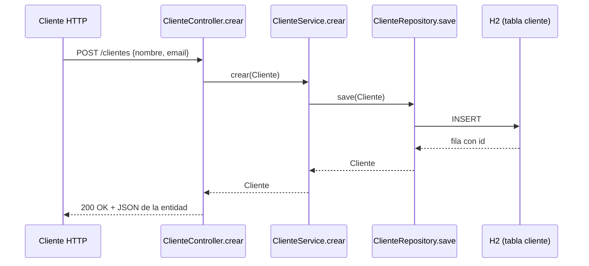

# Mapa del código — Portal de Clientes

Mapa para quien llega nuevo al proyecto: cómo está montado, por dónde pasa una petición y qué ficheros se tocan en cada ticket. Describe el código tal como está hoy (etiqueta `tema-09`). Las reglas que hay que seguir están en [CLAUDE.md](../CLAUDE.md); aquí solo se describe lo que hay y su deuda.

## 1. Capas y qué hace cada clase

Paquete base: `com.imagina.demo` (`src/main/java/com/imagina/demo/`).

| Capa | Fichero | Qué hace |
|---|---|---|
| Arranque | `DemoApplication.java` | Clase `@SpringBootApplication` con el `main`. |
| Controller | `controller/ClienteController.java` | `@RestController` en `/clientes`. Métodos: `listar()` (`GET /clientes`), `obtener(Long id)` (`GET /clientes/{id}`, 404 si no existe, con `Optional.map`), `crear(Cliente)` (`POST /clientes`, devuelve 200 con el cliente guardado) y `eliminar(Long id)` (`DELETE /clientes/{id}`, 204). Solo llama a `ClienteService`. |
| Service | `service/ClienteService.java` | `@Service` con inyección por constructor de `ClienteRepository`. Métodos: `listarTodos()` (`findAll`), `buscarPorId(Long)` (`findById`), `crear(Cliente)` (`save`) y `eliminar(Long)` (`deleteById`, borrado físico). Sin lógica de negocio. |
| Repository | `repository/ClienteRepository.java` | Interfaz `JpaRepository<Cliente, Long>` sin métodos propios. |
| Model | `model/Cliente.java` | Entidad JPA `Cliente` con `id` (`IDENTITY`), `nombre` y `email`, constructor vacío, constructor `(nombre, email)` y getters/setters. |

Configuración: `src/main/resources/application.properties` (H2 en memoria `jdbc:h2:mem:demodb`, `ddl-auto=create-drop`, `show-sql=true`, consola H2 activada).

Tests: `src/test/java/com/imagina/demo/ClienteControllerTest.java`, test de integración con `@SpringBootTest(webEnvironment = RANDOM_PORT)` y `TestRestTemplate`:
- `crearYObtenerCliente()`: `POST /clientes` y `GET /clientes/{id}`.
- `listarClientesDevuelveOk()`: `GET /clientes` leído como `Cliente[]`; solo comprueba el código 2xx.

## 2. Recorrido de `POST /clientes`

1. La petición HTTP llega a `ClienteController.crear(@RequestBody Cliente cliente)`. Jackson convierte el JSON directamente en la **entidad** `Cliente` (cualquier campo de la entidad, incluido `id`, se acepta).
2. El controller llama a `ClienteService.crear(cliente)`, que no valida ni transforma nada.
3. `ClienteService.crear` llama a `ClienteRepository.save(cliente)` (heredado de `JpaRepository`).
4. Hibernate inserta la fila en la tabla `cliente` de H2 (o la actualiza si llega un `id` existente).
5. La entidad guardada vuelve por las mismas capas y se serializa a JSON con estado 200.

## 3. Ticket → ficheros que se tocarían

| Ticket | Ficheros |
|---|---|
| Baja lógica de clientes | `src/main/java/com/imagina/demo/model/Cliente.java` (campo nuevo), `src/main/java/com/imagina/demo/repository/ClienteRepository.java` (consultas que filtren activos), `src/main/java/com/imagina/demo/service/ClienteService.java` (`eliminar`, `listarTodos`, `buscarPorId`), `src/test/java/com/imagina/demo/` (test nuevo). El controller no debería cambiar. |
| Paginación del listado | `src/main/java/com/imagina/demo/controller/ClienteController.java` (`listar`), `src/main/java/com/imagina/demo/service/ClienteService.java` (`listarTodos`), `src/main/java/com/imagina/demo/repository/ClienteRepository.java`, posiblemente `src/main/resources/application.properties` (tamaño máximo), `src/test/java/com/imagina/demo/ClienteControllerTest.java` (`listarClientesDevuelveOk` lee hoy un array). |
| Control de duplicados por email | `src/main/java/com/imagina/demo/service/ClienteService.java` (`crear`), `src/main/java/com/imagina/demo/repository/ClienteRepository.java` (consulta de existencia por email), `src/main/java/com/imagina/demo/controller/ClienteController.java` (código de error), tests nuevos en `src/test/java/com/imagina/demo/`. |
| Buscador por nombre | `src/main/java/com/imagina/demo/controller/ClienteController.java` (endpoint nuevo), `src/main/java/com/imagina/demo/service/ClienteService.java`, `src/main/java/com/imagina/demo/repository/ClienteRepository.java` (consulta parametrizada, sin distinguir mayúsculas), test de integración nuevo en `src/test/java/com/imagina/demo/`. |

## 4. Deuda técnica

Se anota aquí; no se corrige en este tema.

| Deuda | Dónde se ve | Dónde se resuelve |
|---|---|---|
| Entidades JPA expuestas en la API: el controller recibe y devuelve `Cliente`; un `POST` con `id` puede sobrescribir otro cliente (asignación masiva). | `ClienteController.crear`, `listar`, `obtener` | Tema 15 (DTOs) |
| Sin validación de entrada: se guarda cualquier `nombre` y `email`, incluso nulos. | `ClienteController.crear`, `ClienteService.crear` | Tema 18 |
| Sin manejo global de errores (no hay `@ControllerAdvice`). | Paquete `controller` | Tema 18 |
| Consola H2 activa. | `application.properties` (`spring.h2.console.enabled=true`) | Tema 18 |
| SQL en el log (`spring.jpa.show-sql=true`) y esquema recreado al arrancar (`ddl-auto=create-drop`): válidos para la demo, no para producción. | `application.properties` | Pendiente |
| `GET /clientes` carga la tabla entera (`findAll`). | `ClienteService.listarTodos` | Ticket de paginación |
| Borrado físico: se pierde el histórico. | `ClienteService.eliminar` | Ticket de baja lógica |
| `POST /clientes` responde 200 en lugar de 201 y sin cabecera `Location`. | `ClienteController.crear` | Pendiente de decidir |
| Cobertura mínima: `listarClientesDevuelveOk` solo comprueba el código 2xx; no hay test de `DELETE` ni de 404. | `ClienteControllerTest` | Temas 12 y 13 |

## 5. No verificado

- El comportamiento de `deleteById` con un id inexistente (en Spring Data JPA 3.x se ignora sin excepción): no verificado ejecutándolo.
- Que la consola H2 sea accesible en `/h2-console` (lo dice el `README.md`): no verificado arrancando la aplicación.
