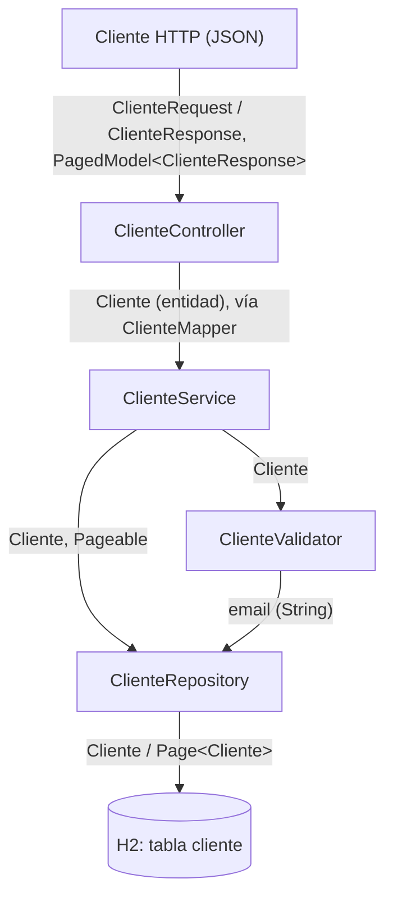

# Arquitectura — Portal de Clientes

Descripción corta de la arquitectura **tal como está hoy en el código** (rama `feature/redmine-21-dtos`). Para el recorrido detallado de una petición y la tabla de tickets, ver el [mapa del código](CODEBASE_MAP.md). Las reglas del equipo están en [CLAUDE.md](../CLAUDE.md).

## 1. Capas

Paquete base `com.imagina.demo` (`src/main/java/com/imagina/demo/`). Arquitectura en capas clásica: controlador → servicio → repositorio.

| Capa | Clases | Responsabilidad |
|---|---|---|
| Controlador (`controller`) | `ClienteController`, `ClienteRequest`, `ClienteResponse`, `ClienteMapper` | Recibe y devuelve JSON. Convierte DTO ↔ entidad con `ClienteMapper`, llama a `ClienteService` y traduce las excepciones de negocio a códigos HTTP (`@ExceptionHandler` con `ProblemDetail`). No contiene lógica de negocio ni usa el repositorio. |
| Servicio (`service`) | `ClienteService`, `ClienteValidator`, `EmailInvalidoException`, `ClienteDuplicadoException` | Reglas de negocio: normalización del email (`trim`), validación de formato, control de duplicados (en `ClienteValidator`) y baja lógica (`ClienteService.eliminar` marca `activo = false`). |
| Repositorio (`repository`) | `ClienteRepository` | `JpaRepository<Cliente, Long>` con consultas derivadas: `findByActivoTrue(Pageable)`, `findByIdAndActivoTrue(Long)` y `existsByEmailIgnoreCaseAndActivoTrue(String)`. |
| Modelo (`model`) | `Cliente` | Entidad JPA: `id`, `nombre`, `email` y `activo` (verdadero por defecto). |

Base de datos: H2 en memoria (`src/main/resources/application.properties`).

## 2. Diagrama



## 3. Regla

**La API nunca expone entidades JPA.** El controlador solo recibe `ClienteRequest` y devuelve `ClienteResponse` (o `PagedModel<ClienteResponse>`). La entidad `Cliente` no cruza la frontera HTTP: la conversión se hace en `ClienteMapper`, y el `id` y el estado `activo` nunca se toman de la petición.

## 4. Contrato de la API

| Método y ruta | Recibe | Devuelve |
|---|---|---|
| `GET /clientes` | Parámetros `page` (desde 0), `size` (20 por defecto, máximo 100) y `sort` (por `id` por defecto) | 200 con el listado paginado de clientes **activos** |
| `GET /clientes/{id}` | — | 200 con `ClienteResponse`; 404 si no existe o está dado de baja |
| `POST /clientes` | `ClienteRequest` `{ "nombre", "email" }`; otros campos (`id`, `activo`) se ignoran | 200 con `ClienteResponse`; 400 si el email no es válido; 409 si ya existe un cliente activo con el mismo email (sin distinguir mayúsculas ni espacios alrededor) |
| `DELETE /clientes/{id}` | — | 204 siempre (baja lógica; también si no existe o ya estaba dado de baja) |

`ClienteResponse`: `{ "id", "nombre", "email" }`. Los errores 400 y 409 se devuelven como `ProblemDetail` (`application/problem+json`), sin trazas.

Formato del listado (`PagedModel`):

```json
{
  "content": [ { "id": 1, "nombre": "Cliente Ficticio", "email": "cliente001@example.com" } ],
  "page": { "size": 20, "number": 0, "totalElements": 1, "totalPages": 1 }
}
```

## 5. Patrones presentes

| Patrón | Dónde |
|---|---|
| Repository | `repository/ClienteRepository.java` |
| Service | `service/ClienteService.java` |
| DTO | `controller/ClienteRequest.java`, `controller/ClienteResponse.java` (records) y `controller/ClienteMapper.java` |
| Validator | `service/ClienteValidator.java` |
| Inyección por constructor | `ClienteController` (recibe `ClienteService`), `ClienteService` (recibe `ClienteRepository` y `ClienteValidator`), `ClienteValidator` (recibe `ClienteRepository`) |

## 6. Deuda pendiente

- Validación de entrada con `@Valid` (por ejemplo, `nombre` vacío se acepta): tema 18.
- Manejo global de errores: hoy los `@ExceptionHandler` están en `ClienteController`, no en un `@ControllerAdvice`: tema 18.
- Consola H2 activa (`spring.h2.console.enabled=true`): tema 18.
- `POST /clientes` responde 200 en lugar de 201 y sin cabecera `Location`.
- Sin restricción única en la base de datos para el email: dos altas simultáneas podrían saltarse el control de duplicados.

## 7. No verificado

- El nombre exacto de los campos dentro de `page` en el JSON (`size`, `number`, `totalElements`, `totalPages`): tomado de la documentación de `PagedModel` de Spring Data; los tests solo comprueban `totalElements`.
- Que el aviso `PlainPageSerializationWarning` haya desaparecido del log: no verificado arrancando la aplicación.
